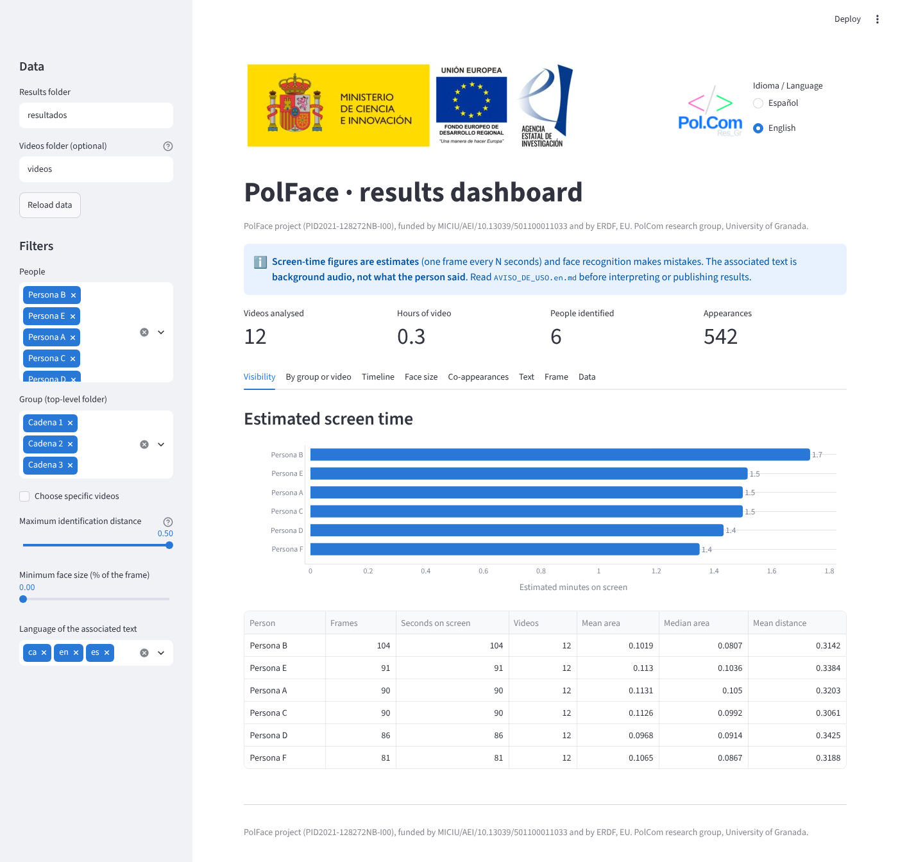

<p align="center">
  
</p>

<p align="center"><sub>Project PID2021-128272NB-I00 funded by MICIU/AEI/10.13039/501100011033 and by ERDF, EU</sub></p>

<p align="center">
  <a href="https://wpd.ugr.es/~polcom/"></a>
</p>

<p align="center"><a href="README.md">Español</a> · <b>English</b></p>

# PolFace

**PolFace: a tool for locating political figures in television video** (debates, news, talk shows…; it works on any video and on the people you supply photos for).
Software from the PolFace research project, developed by the **PolCom** research group (University of Granada).

A research tool to **locate people in television video** and obtain **descriptive visibility measures** (estimated screen time, face size, co-appearances). You provide the videos and the photos of the people you want to find; the tool does the rest.

## The project

| | |
|---|---|
| **Project** | PolFace: a tool for locating political figures on Spanish television |
| **Reference** | PID2021-128272NB-I00 (Knowledge Generation Projects 2021, non-oriented research) |
| **Principal investigator** | Javier García Marín ([ORCID 0000-0002-2766-0266](https://orcid.org/0000-0002-2766-0266)) |
| **Group** | PolCom |
| **Institution** | University of Granada · Faculty of Political Science and Sociology |
| **Execution period** | 01/09/2022 – 31/08/2026 |
| **Funding** | MICIU/AEI/10.13039/501100011033 and ERDF, EU (“A way of making Europe”) |

> **Read [AVISO_DE_USO.en.md](AVISO_DE_USO.en.md) before using it.** It identifies people through face recognition (biometric data), the InsightFace models are for non-commercial research only, and the repository does not include (and must never include) faces, galleries or videos.

## How it works

```
videos ──┐
         ├─► polface analizar ─► detecciones.csv + videos.csv ─► polface resumen ─► descriptive tables
reference│                                  │
photos ──► polface galeria ─► galeria.npz ──┘
                                            ▼
videos ─► polface transcribir ─► transcripciones/ ─► polface texto ─► texto_analizado/ ─► polface unir ─► detecciones_texto.csv
                                  (language detected)   (sentiment and toxicity)
```

The command names are Spanish (`galeria` = gallery, `analizar` = analyse, `resumen` = summary, `transcribir` = transcribe, `texto` = text, `unir` = join).

1. `galeria`: computes face embeddings from the reference photos (one folder per person).
2. `analizar`: takes one frame every *N* seconds, detects faces, compares them with the gallery and stores where each person is (face box, time, distance).
3. `resumen`: computes estimated screen time per person and per video, relative face size and the co-appearance matrix.
4. `transcribir` *(optional)*: transcribes the videos with Whisper ([faster-whisper](https://github.com/SYSTRAN/faster-whisper)) and saves a CSV of segments with start and end times per video.
5. `texto` *(optional)*: computes the **sentiment** and **toxicity** of each transcribed segment with multilingual models, according to the language Whisper detected.
6. `unir` *(optional)*: attaches to each appearance the text heard in a time window around it (±5 s by default) and, if you ran `texto`, the mean sentiment and maximum toxicity of that window.

## Easy installation (no terminal needed)

Download the repository (on GitHub: *Code → Download ZIP*), unzip it and double-click the launcher for your system. The first time it installs everything (a few minutes and several hundred MB, internet connection needed) and opens the dashboard in your browser; afterwards it opens it straight away.

| System | Launcher | Requirements |
|---|---|---|
| Windows | `PolFace.bat` | [Python 3.9 or later](https://www.python.org/downloads/) (tick *Add python.exe to PATH*). InsightFace may need the [Microsoft C++ Build Tools](https://visualstudio.microsoft.com/visual-cpp-build-tools/). |
| macOS | `PolFace.command` | Python 3.9 or later. If double-click does not work: `chmod +x PolFace.command PolFace.sh`. |
| Linux | `./PolFace.sh` | Python 3.9 or later (and `python3-venv`). |

With `PolFace.sh --completo` (or `PolFace.bat completo`) transcription and sentiment/toxicity are installed too. In the dashboard, choose the videos folder and the faces folder and press **▶ Analyse**. Typing just `polface` in a terminal also works.

## Installation (terminal)

Requires Python 3.9 or later.

```bash
git clone https://github.com/Pol-Com-UGR/PolFace.git
cd PolFace
python -m venv .venv && source .venv/bin/activate
pip install -e .
# With an NVIDIA GPU: pip uninstall onnxruntime && pip install onnxruntime-gpu
# To transcribe with Whisper:    pip install -e ".[transcripcion]"
# For sentiment and toxicity:    pip install -e ".[texto]"
# For the interactive dashboard: pip install -e ".[dashboard]"
```

The first time, InsightFace downloads the `buffalo_l` model into `~/.insightface`, and Whisper downloads the chosen model (`large-v3` by default, about 3 GB) into the Hugging Face cache.

## Try it in one minute (no videos or models needed)

```bash
pip install -e ".[dashboard]"
polface demo --abrir --lang en  # creates synthetic data and opens the dashboard (http://localhost:8501)
```

The sample data is invented (people “A”, “B”…). It lets you see what the dashboard looks like before analysing your own videos.

## Language

The command-line messages and the dashboard are available in **Spanish and English**. Choose with `--lang es|en` (in any position) or with the environment variable `POLFACE_LANG=en`. The dashboard also has a visible selector at the top right. Command names (`galeria`, `analizar`…) and CSV column names are always Spanish.

## Usage

```bash
# 1. Prepare referencias/<Person>/photo.jpg (see ejemplos/referencias/LEEME.md)
polface galeria referencias/ --salida galeria.npz

# 2. Analyse a folder of videos (or a single video)
polface analizar mis_videos/ --galeria galeria.npz --salida resultados/ --cada-segundos 1 --area-minima 6400

# 3. Descriptive statistics
polface resumen resultados/

# 4. (Optional) Transcription and text associated with each appearance
polface transcribir mis_videos/ --salida transcripciones/ --modelo large-v3
polface texto transcripciones/ --salida texto_analizado/
polface unir resultados/ --transcripciones texto_analizado/ --ventana-segundos 5

# Shortcut: steps 1-3 in one go (gallery + analysis + descriptives)
polface procesar mis_videos/ --caras referencias/ --salida resultados/

# 5. Interactive dashboard to explore the results (in English)
polface --lang en dashboard resultados/ --videos mis_videos/ --caras referencias/
```

Useful options of `analizar`:

| Option | Purpose |
|---|---|
| `--cada-segundos 1` | One frame every N seconds. Smaller = more precise and slower. |
| `--umbral 0.5` | Maximum cosine distance to accept an identification. Lower = stricter. **Calibrate it with your data.** |
| `--area-minima 6400` | Ignore small faces (6400 = 80×80 px), e.g. faces on background screens. |
| `--guardar-desconocidos` | Also save the unidentified faces (without a name). |
| `--reanudar` | Skip videos already processed in the output folder. |
| `--dispositivo cpu\|cuda\|auto` | Where to run the model. |

### Output files

- `detecciones.csv`: one row per identified face (`video, fotograma, tiempo_seg, persona, distancia, distancia_segunda, x, y, ancho, alto, area_relativa, score_deteccion`).
- `videos.csv`: duration, fps and sampled frames per video.
- `resumen_por_persona.csv`, `resumen_por_video.csv`, `coapariciones.csv`.
- `transcripciones/<video>.csv`: Whisper segments (`video, inicio, fin, texto, idioma, prob_idioma, avg_logprob, no_speech_prob`).
- `texto_analizado/<video>.csv`: the above plus `sent_neg, sent_neu, sent_pos, sent_polaridad` (probabilities and polarity = pos − neg), `tox_*` (toxicity and subtypes) and the `sent_ok`/`tox_ok` flags (whether the segment could be scored).
- `detecciones_texto.csv`: `detecciones.csv` plus `texto`, `n_segmentos_texto`, `idioma_texto` and, where applicable, `sent_*` (window mean) and `tox_*` (window maximum).

> **The joined text is background audio, not speech by the person.** Speakers are not separated: in a news bulletin the presenter is usually the one talking while a politician is on screen. Use it to analyse what is being talked about when someone appears, not to attribute quotes to them.

Options of `transcribir`: `--modelo` (`large-v3` is the most accurate; `large-v3-turbo` is much faster; without a GPU use `medium` or `small`), `--idioma auto|es|en|...` (default `auto`: Whisper detects each video's language), `--dispositivo auto|cpu|cuda`, `--rehacer` (by default, already transcribed videos are skipped) and `--mostrar` (print each phrase).

Screen-time figures are **estimates**: each sampled frame represents `--cada-segundos` seconds.

## Multiple languages

PolFace is designed for videos in any language:

- **Transcription:** Whisper (multilingual model) transcribes about 100 languages and detects each video's language. If a video mixes languages, fix it with `--idioma`.
- **Sentiment and toxicity:** each model is only validated on certain languages. If a segment's language is not on that list it is **not scored** (left empty, with a warning) rather than given a meaningless number. `--forzar-idioma` scores it anyway, without validation.

| | Model | Declared languages | Licence |
|---|---|---|---|
| Sentiment (default) | [`lxyuan/distilbert-base-multilingual-cased-sentiments-student`](https://huggingface.co/lxyuan/distilbert-base-multilingual-cased-sentiments-student) | en, es, fr, de, it, pt, ar, hi, id, ms, ja, zh | Apache-2.0 |
| Sentiment (`--sentimiento cardiffnlp`) | [`cardiffnlp/twitter-xlm-roberta-base-sentiment`](https://huggingface.co/cardiffnlp/twitter-xlm-roberta-base-sentiment) (trained on tweets) | ar, en, fr, de, hi, it, es, pt | not stated on the model card: check it |
| Toxicity | [Detoxify `multilingual`](https://github.com/unitaryai/detoxify) (XLM-RoBERTa base) | en, es, fr, it, pt, tr, ru | package Apache-2.0 |

**Catalan, Basque and Galician** are not among the validated languages of these models, although Whisper does transcribe them. By default those segments are left unscored.

These scores are **approximate**: a sentiment model trained on reviews or tweets does not measure the political tone of a news item, and toxicity classifiers flag any text containing insults even if it is a quotation or a complaint. Validate them with a hand-coded sample in your language (see below).

## Interactive dashboard

`polface dashboard resultados/` opens a dashboard in your browser (Streamlit + Plotly) that reads the CSV files in the results folder; nothing leaves your computer. If you pass `--videos mis_videos/`, the *Frame* tab draws the face boxes on the original video. Options: `--puerto 8501`, `--sin-navegador`, `--idioma es|en` (initial language; defaults to `--lang`).

- **Language:** the dashboard is available in **Spanish and English**; switch with the selector at the top right (your filters are kept).
- **Analyse from the dashboard:** choose the videos folder and the faces folder, adjust the options (one frame every N s, threshold, minimum area, optional transcription) and press **▶ Analyse**. It runs on your computer in the background, with a progress bar and a log, and the charts and tables appear when it finishes. It is the same as `polface procesar videos/ --caras caras/ --salida resultados/` in the terminal. The results (and the face gallery `galeria.npz`) stay in the results folder: do not upload it to any repository.
- **Folders:** the results, videos and faces folders (`--caras referencias/`) can be typed or chosen with the “Browse…” button (system picker; if unavailable, a built-in folder finder). **The people list comes from the faces folder**: everyone you offer to the program appears (with 0 if they never show up) and detected people no longer in it are hidden. Without a faces folder, the detected people are used.
- **Filters** (sidebar): people, group (first folder of the video path, e.g. the channel), specific videos, maximum identification distance, minimum face size and language of the text (only affects the Text tab; Spanish and English by default).
- **Tabs:** visibility (estimated minutes on screen), by group or video, timeline, face size, co-appearances, text (polarity, toxicity and languages, if you ran `unir`), frame and data (downloadable table).
- The header and footer show the project funding, and a reminder that the figures are estimates.



*Screenshot with synthetic data (fictitious names; the sample texts are in Spanish).*

## Recommended validation

Hand-label a sample of your own videos (for example, 200 frames), run the tool on them and compute precision and coverage to choose the threshold. Do the same for sentiment and toxicity: hand-code a sample of segments **in each language you will analyse** and compare. Publish those figures with your results.

## Status and roadmap

- [x] Detection and identification on video, output CSV and descriptive statistics (`v0.1`)
- [x] Interactive dashboard (Streamlit) to explore results and see detections on frames, in Spanish and English
- [x] Whisper transcription and joining with appearances by time window
- [x] Multilingual sentiment and toxicity with language control
- [ ] Speaker diarisation to attribute text to whoever speaks
- [ ] Threshold calibration script using a labelled sample
- [ ] Optional emotions module (off by default, with validity warnings)

## Tests

```bash
pip install -e ".[dev]"
pytest
```

The tests do not need to download any model: they use a simulated detector and a synthetic video.

## How to cite

If you use PolFace in a publication, please cite it as follows (GitHub also offers "Cite this repository" in the right-hand column, built from [CITATION.cff](CITATION.cff)):

> García Marín, J., Luengo, Ó. G., & Serrano Contreras, I. J. (2026). *PolFace: locating political figures in television video* (v0.1.0) [Software]. PolCom group, University of Granada. https://github.com/Pol-Com-UGR/PolFace

```bibtex
@software{garciamarin_polface_2026,
  author  = {García Marín, Javier and Luengo, Óscar G. and Serrano Contreras, Ignacio Jesús},
  title   = {PolFace: locating political figures in television video},
  year    = {2026},
  version = {0.1.0},
  url     = {https://github.com/Pol-Com-UGR/PolFace},
  note    = {Project PID2021-128272NB-I00, MICIU/AEI/10.13039/501100011033 and FEDER, UE}
}
```

Please also cite InsightFace.

## Licence

Code under the MIT licence (see [LICENSE](LICENSE)). The InsightFace models have their own terms (non-commercial research only).

## Funding and acknowledgements

This work is part of project **PID2021-128272NB-I00**, funded by MICIU/AEI/10.13039/501100011033 and by ERDF, EU.

<p align="center">
  
</p>

## Research group

**Pol.Com (Political Communication)**, University of Granada: a research group studying how communication shapes political processes (traditional media, social media, polarisation, text-analysis and computer-vision algorithms, populism and election debates).

- Web: <https://wpd.ugr.es/~polcom/>
- GitHub: <https://github.com/Pol-Com-UGR>
- Email: <polcom@ugr.es>
- Address: C/ Rector López Argueta s/n, 18071 Granada (Spain)
