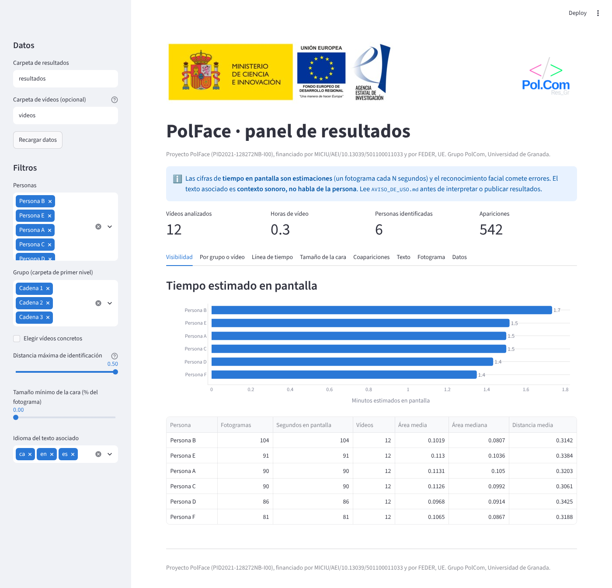
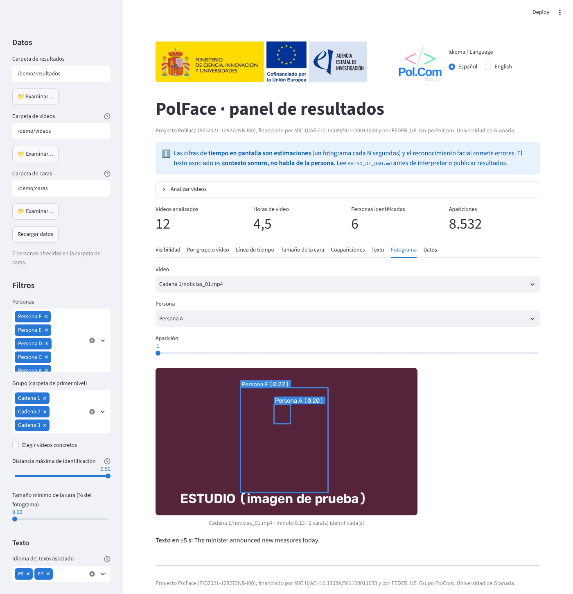

<p align="center">
  
</p>

<p align="center"><sub>Proyecto PID2021-128272NB-I00 financiado por MICIU/AEI/10.13039/501100011033 y por FEDER, UE</sub></p>

<p align="center">
  <a href="https://wpd.ugr.es/~polcom/"></a>
</p>

<p align="center"><b>Español</b> · <a href="README.en.md">English</a></p>

> **English version:** [README.en.md](README.en.md). PolFace locates political figures in television video from your own photos and videos, and gives descriptive visibility statistics and an interactive dashboard (Spanish/English).

# PolFace

**PolFace: herramienta de localización de figuras políticas en vídeo de televisión** (debates, informativos, programas…; funciona con cualquier vídeo y con las personas de las que aportes fotos).
Software del proyecto de investigación PolFace, desarrollado por el grupo de investigación **PolCom** (Universidad de Granada).

Herramienta de investigación para **localizar personas en vídeo de televisión** y obtener **descriptivos de visibilidad** (tiempo estimado en pantalla, tamaño de la cara, coapariciones). Tú aportas los vídeos y las fotos de las personas que quieres buscar; la herramienta hace el resto.

## El proyecto

| | |
|---|---|
| **Proyecto** | PolFace: herramienta de localización de figuras políticas en las televisiones españolas |
| **Referencia** | PID2021-128272NB-I00 (Proyectos de Generación de Conocimiento 2021, investigación no orientada) |
| **Investigador principal** | Javier García Marín ([ORCID 0000-0002-2766-0266](https://orcid.org/0000-0002-2766-0266)) |
| **Grupo** | PolCom |
| **Entidad** | Universidad de Granada · Facultad de Ciencias Políticas y Sociología |
| **Periodo de ejecución** | 01/09/2022 – 31/08/2026 |
| **Financiación** | MICIU/AEI/10.13039/501100011033 y FEDER, UE («Una manera de hacer Europa») |

> **Léete [AVISO_DE_USO.md](AVISO_DE_USO.md) antes de usarla** ([English](AVISO_DE_USO.en.md)). Identifica personas por reconocimiento facial (datos biométricos), los modelos de InsightFace son solo para investigación no comercial, y el repositorio no incluye ni debe incluir caras, galerías ni vídeos.

## Cómo funciona

```
vídeos ──┐
         ├─► polface analizar ─► detecciones.csv + videos.csv ─► polface resumen ─► tablas descriptivas
fotos de │                                  │
referencia ─► polface galeria ─► galeria.npz ┘
                                            ▼
vídeos ─► polface transcribir ─► transcripciones/ ─► polface texto ─► texto_analizado/ ─► polface unir ─► detecciones_texto.csv
                                  (idioma detectado)   (sentimiento y toxicidad)
```

1. `galeria`: calcula los embeddings faciales de las fotos de referencia (una carpeta por persona).
2. `analizar`: toma un fotograma cada *N* segundos, detecta las caras, las compara con la galería y guarda dónde está cada persona (caja de la cara, tiempo, distancia).
3. `resumen`: calcula tiempo estimado en pantalla por persona y por vídeo, tamaño relativo de la cara y matriz de coapariciones.
4. `transcribir` *(opcional)*: transcribe los vídeos con Whisper ([faster-whisper](https://github.com/SYSTRAN/faster-whisper)) y guarda un CSV de segmentos con su tiempo de inicio y fin por vídeo.
5. `texto` *(opcional)*: calcula el **sentimiento** y la **toxicidad** de cada segmento transcrito con modelos multilingües, según el idioma detectado por Whisper.
6. `unir` *(opcional)*: añade a cada aparición el texto que se oye en una ventana de tiempo a su alrededor (por defecto ±5 s) y, si has ejecutado `texto`, el sentimiento medio y la toxicidad máxima de esa ventana.

## Instalación sencilla (sin usar la terminal)

Descarga el repositorio (en GitHub: *Code → Download ZIP*), descomprímelo y haz doble clic en el lanzador de tu sistema. La primera vez instala todo (unos minutos y varios cientos de MB, con conexión a internet) y abre el panel en tu navegador; las siguientes veces lo abre directamente.

| Sistema | Lanzador | Requisitos |
|---|---|---|
| Windows | `PolFace.bat` | [Python 3.9 o superior](https://www.python.org/downloads/) (marca *Add python.exe to PATH*). InsightFace puede necesitar las [Microsoft C++ Build Tools](https://visualstudio.microsoft.com/visual-cpp-build-tools/). |
| macOS | `PolFace.command` | Python 3.9 o superior. Si no se abre con doble clic: `chmod +x PolFace.command PolFace.sh`. |
| Linux | `./PolFace.sh` | Python 3.9 o superior (y `python3-venv`). |

Con `PolFace.sh --completo` (o `PolFace.bat completo`) se instalan también la transcripción y el sentimiento/toxicidad. En el panel, elige la carpeta de vídeos y la de caras y pulsa **▶ Analizar**. También funciona escribiendo solo `polface` en una terminal.

## Instalación (terminal)

Requiere Python 3.9 o superior.

```bash
git clone https://github.com/Pol-Com-UGR/PolFace.git
cd PolFace
python -m venv .venv && source .venv/bin/activate
pip install -e .
# Con GPU NVIDIA: pip uninstall onnxruntime && pip install onnxruntime-gpu
# Para transcribir con Whisper: pip install -e ".[transcripcion]"
# Para sentimiento y toxicidad:  pip install -e ".[texto]"
# Para el panel interactivo:     pip install -e ".[dashboard]"
```

La primera vez, InsightFace descargará el modelo `buffalo_l` en `~/.insightface`, y Whisper el modelo elegido (por defecto `large-v3`, unos 3 GB) en la caché de Hugging Face.

## Probarlo en un minuto (sin vídeos ni modelos)

```bash
pip install -e ".[dashboard]"
polface demo --abrir            # crea datos sintéticos y abre el panel (http://localhost:8501)
polface demo --abrir --lang en  # lo mismo, con mensajes y panel en inglés
```

Los datos de ejemplo son inventados (personas «A», «B»…). Sirven para ver cómo es el panel antes de analizar tus vídeos.

## Idioma

Los mensajes de la línea de comandos y el panel están en **español e inglés**. Elige con `--lang es|en` (en cualquier posición) o con la variable de entorno `POLFACE_LANG=en`. En el panel, además, hay un selector visible arriba a la derecha. Los nombres de las órdenes (`galeria`, `analizar`…) y de las columnas de los CSV son siempre en español.

## Uso

```bash
# 1. Prepara referencias/<Persona>/foto.jpg (ver ejemplos/referencias/LEEME.md)
polface galeria referencias/ --salida galeria.npz

# 2. Analiza una carpeta de vídeos (o un solo vídeo)
polface analizar mis_videos/ --galeria galeria.npz --salida resultados/ --cada-segundos 1 --area-minima 6400

# 3. Descriptivos
polface resumen resultados/

# 4. (Opcional) Transcripción y texto asociado a cada aparición
polface transcribir mis_videos/ --salida transcripciones/ --modelo large-v3
polface texto transcripciones/ --salida texto_analizado/
polface unir resultados/ --transcripciones texto_analizado/ --ventana-segundos 5

# Atajo: los pasos 1-3 de una vez (galería + análisis + descriptivos)
polface procesar mis_videos/ --caras referencias/ --salida resultados/

# 5. Panel interactivo para explorar los resultados
polface dashboard resultados/ --videos mis_videos/ --caras referencias/
```

Opciones útiles de `analizar`:

| Opción | Para qué |
|---|---|
| `--cada-segundos 1` | Un fotograma cada N segundos. Más pequeño = más preciso y más lento. |
| `--umbral 0.5` | Distancia coseno máxima para aceptar una identificación. Menor = más estricto. **Calíbralo con tus datos.** |
| `--area-minima 6400` | Ignora caras pequeñas (6400 = 80×80 px), p. ej. caras en pantallas de fondo. |
| `--guardar-desconocidos` | Guarda también las caras no identificadas (sin nombre). |
| `--reanudar` | Omite los vídeos ya procesados en la carpeta de salida. |
| `--dispositivo cpu\|cuda\|auto` | Dónde ejecutar el modelo. |

### Ficheros de salida

- `detecciones.csv`: una fila por cara identificada (`video, fotograma, tiempo_seg, persona, distancia, distancia_segunda, x, y, ancho, alto, area_relativa, score_deteccion`).
- `videos.csv`: duración, fps y fotogramas muestreados por vídeo.
- `resumen_por_persona.csv`, `resumen_por_video.csv`, `coapariciones.csv`.
- `transcripciones/<video>.csv`: segmentos de Whisper (`video, inicio, fin, texto, idioma, prob_idioma, avg_logprob, no_speech_prob`).
- `texto_analizado/<video>.csv`: lo anterior más `sent_neg, sent_neu, sent_pos, sent_polaridad` (probabilidades y polaridad = pos − neg), `tox_*` (toxicidad y subtipos) y las marcas `sent_ok`/`tox_ok` (si el segmento se pudo puntuar).
- `detecciones_texto.csv`: `detecciones.csv` más `texto`, `n_segmentos_texto`, `idioma_texto` y, si procede, `sent_*` (media de la ventana) y `tox_*` (máximo de la ventana).

> **El texto unido es contexto sonoro, no habla de la persona.** No hay separación de hablantes: en un informativo suele hablar el presentador mientras se ve a un político. Úsalo para analizar de qué se habla cuando aparece alguien, no para atribuirle frases.

Opciones de `transcribir`: `--modelo` (`large-v3` es el más preciso; `large-v3-turbo` es mucho más rápido; sin GPU usa `medium` o `small`), `--idioma auto|es|en|...` (por defecto `auto`: Whisper detecta el idioma de cada vídeo), `--dispositivo auto|cpu|cuda`, `--rehacer` (por defecto se saltan los vídeos ya transcritos) y `--mostrar` (enseña cada frase).

Las cifras de tiempo en pantalla son **estimaciones**: cada fotograma muestreado representa `--cada-segundos` segundos.

## Varios idiomas

PolFace está pensado para vídeos en cualquier idioma:

- **Transcripción:** Whisper (modelo multilingüe) transcribe unos 100 idiomas y detecta el idioma de cada vídeo. Si un vídeo mezcla idiomas, fíjalo con `--idioma`.
- **Sentimiento y toxicidad:** cada modelo solo está validado en ciertos idiomas. Si el idioma de un segmento no está en esa lista, **no se puntúa** (queda vacío y se avisa) en vez de dar una cifra sin sentido. `--forzar-idioma` lo puntúa igualmente, sin validación.

| | Modelo | Idiomas declarados | Licencia |
|---|---|---|---|
| Sentimiento (por defecto) | [`lxyuan/distilbert-base-multilingual-cased-sentiments-student`](https://huggingface.co/lxyuan/distilbert-base-multilingual-cased-sentiments-student) | en, es, fr, de, it, pt, ar, hi, id, ms, ja, zh | Apache-2.0 |
| Sentimiento (`--sentimiento cardiffnlp`) | [`cardiffnlp/twitter-xlm-roberta-base-sentiment`](https://huggingface.co/cardiffnlp/twitter-xlm-roberta-base-sentiment) (entrenado con tuits) | ar, en, fr, de, hi, it, es, pt | ver la ficha del modelo |
| Toxicidad | [Detoxify `multilingual`](https://github.com/unitaryai/detoxify) (XLM-RoBERTa base) | en, es, fr, it, pt, tr, ru | paquete Apache-2.0 |

El **catalán, el euskera y el gallego** no están entre los idiomas validados de estos modelos, aunque Whisper sí los transcribe. Por defecto esos segmentos quedan sin puntuar.

Estas puntuaciones son **aproximadas**: un modelo de sentimiento entrenado con reseñas o tuits no mide el tono político de una noticia, y los clasificadores de toxicidad marcan como tóxico cualquier texto con insultos aunque sea una cita o una denuncia. Valídalas con una muestra codificada a mano en tu idioma (ver más abajo).

## Panel interactivo

`polface dashboard resultados/` abre en el navegador un panel (Streamlit + Plotly) que lee los CSV de la carpeta de resultados; no envía nada fuera de tu ordenador. Si pasas `--videos mis_videos/`, la pestaña *Fotograma* dibuja las cajas de las caras sobre el vídeo original. Opciones: `--puerto 8501`, `--sin-navegador`, `--idioma es|en` (idioma inicial; por defecto el de `--lang`).

- **Idioma:** el panel está en **español e inglés**; se cambia con el selector de arriba a la derecha (los filtros se conservan).

- **Analizar desde el panel:** elige la carpeta de vídeos y la de caras, ajusta las opciones (un fotograma cada N s, umbral, área mínima, transcripción opcional) y pulsa **▶ Analizar**. Se ejecuta en tu ordenador en segundo plano, con barra de progreso y registro, y al terminar aparecen los gráficos y las tablas. Es lo mismo que `polface procesar videos/ --caras caras/ --salida resultados/` en la terminal. Los resultados (y la galería facial `galeria.npz`) quedan en la carpeta de resultados: no la subas a ningún repositorio.
- **Carpetas:** la carpeta de resultados, la de vídeos y la de caras (`--caras referencias/`) se pueden escribir o elegir con el botón «Examinar…» (selector del sistema; si no está disponible, un buscador de carpetas). **La lista de personas sale de la carpeta de caras**: aparecen todas las que ofreces al programa (con 0 si no salen) y se ocultan las detectadas que ya no están en ella. Sin carpeta de caras, se usan las personas detectadas.
- **Filtros** (barra lateral): personas, grupo (primera carpeta del vídeo, p. ej. la cadena), vídeos concretos, distancia máxima de identificación, tamaño mínimo de la cara e idioma del texto (solo afecta a la pestaña Texto; por defecto, español e inglés).
- **Pestañas**: visibilidad (minutos estimados en pantalla), por grupo o vídeo, línea de tiempo, tamaño de la cara, coapariciones, texto (polaridad, toxicidad e idiomas, si ejecutaste `unir`), fotograma y datos (tabla descargable).
- El panel muestra en cabecera y pie la financiación del proyecto y recuerda que las cifras son estimaciones.





*Capturas con datos sintéticos (nombres ficticios).*

## Validación recomendada

Etiqueta a mano una muestra de tus propios vídeos (por ejemplo, 200 fotogramas), ejecuta la herramienta sobre ellos y calcula precisión y cobertura para elegir el umbral. Haz lo mismo con el sentimiento y la toxicidad: codifica a mano una muestra de segmentos **en cada idioma que vayas a analizar** y compara. Publica esas cifras junto con tus resultados.

## Estado y hoja de ruta

- [x] Detección e identificación sobre vídeo, CSV de salida y descriptivos (`v0.1`)
- [x] Dashboard interactivo (Streamlit, en español e inglés) para explorar los resultados y ver las detecciones sobre los fotogramas
- [x] Transcripción con Whisper y unión con las apariciones por ventana temporal
- [x] Sentimiento y toxicidad multilingües con control de idioma
- [ ] Separación de hablantes (diarización) para atribuir el texto a quien habla
- [ ] Script de calibración del umbral con una muestra etiquetada
- [ ] Módulo opcional de emociones (desactivado por defecto, con advertencias de validez)

## Tests

```bash
pip install -e ".[dev]"
pytest
```

Los tests no necesitan descargar modelos: usan un detector simulado y un vídeo sintético.

## Cómo citar

Si usas PolFace en una publicación, cítalo así (también en [CITATION.cff](CITATION.cff)):

> García Marín, J., García Luengo, Ó., & Serrano Contreras, I. J. (2026). *PolFace: localización de figuras políticas en vídeo de televisión* (v0.1.0) [Software]. Grupo PolCom, Universidad de Granada. https://github.com/Pol-Com-UGR/PolFace

```bibtex
@software{garciamarin_polface_2026,
  author  = {García Marín, Javier and García Luengo, Óscar and Serrano Contreras, Ignacio Jesús},
  title   = {PolFace: localización de figuras políticas en vídeo de televisión},
  year    = {2026},
  version = {0.1.0},
  url     = {https://github.com/Pol-Com-UGR/PolFace},
  note    = {Proyecto PID2021-128272NB-I00, MICIU/AEI/10.13039/501100011033 y FEDER, UE}
}
```

Cita también InsightFace.

## Software y modelos de terceros

PolFace se apoya en proyectos de código abierto. Si publicas resultados obtenidos con él, cita los que hayas usado. Cada uno tiene su propia licencia, indicada en su página.

| Para qué | Proyecto | Enlace |
|---|---|---|
| Detección y reconocimiento facial (obligatorio) | InsightFace (modelo `buffalo_l`) | <https://github.com/deepinsight/insightface> |
| Ejecución de los modelos | ONNX Runtime | <https://onnxruntime.ai> |
| Lectura de vídeo e imagen | OpenCV | <https://opencv.org> |
| Datos | NumPy, pandas | <https://numpy.org>, <https://pandas.pydata.org> |
| Panel interactivo | Streamlit, Plotly | <https://streamlit.io>, <https://plotly.com/python/> |
| Transcripción (opcional) | faster-whisper y Whisper de OpenAI | <https://github.com/SYSTRAN/faster-whisper>, <https://github.com/openai/whisper> |
| Sentimiento (opcional) | `lxyuan/distilbert-base-multilingual-cased-sentiments-student`, `cardiffnlp/twitter-xlm-roberta-base-sentiment` | <https://huggingface.co/lxyuan/distilbert-base-multilingual-cased-sentiments-student>, <https://huggingface.co/cardiffnlp/twitter-xlm-roberta-base-sentiment> |
| Toxicidad (opcional) | Detoxify (`multilingual`) | <https://github.com/unitaryai/detoxify> |
| Modelos de lenguaje | Transformers (Hugging Face), PyTorch | <https://huggingface.co/docs/transformers>, <https://pytorch.org> |

**Importante:** el código de InsightFace es de código abierto, pero sus modelos preentrenados (como `buffalo_l`) se ofrecen solo para **investigación no comercial**. PolFace no incluye ningún modelo: se descargan al usarlo, de modo que la responsabilidad de respetar esas condiciones es de quien lo usa.

## Licencia

Código bajo licencia MIT (ver [LICENSE](LICENSE)). Los modelos de InsightFace tienen sus propias condiciones (solo investigación no comercial).

## Financiación y agradecimientos

Este trabajo forma parte del proyecto **PID2021-128272NB-I00**, financiado por MICIU/AEI/10.13039/501100011033 y por FEDER, UE.

<p align="center">
  
</p>

## Grupo de investigación

**Pol.Com (Political Communication)**, Universidad de Granada: grupo de investigación sobre cómo la comunicación influye en los procesos políticos (medios tradicionales, redes sociales, polarización, algoritmos de análisis de texto y de visión por computador, populismo y debates electorales).

- Web: <https://wpd.ugr.es/~polcom/>
- GitHub: <https://github.com/Pol-Com-UGR>
- Correo: <polcom@ugr.es>
- Dirección: C/ Rector López Argueta s/n, 18071 Granada (España)
